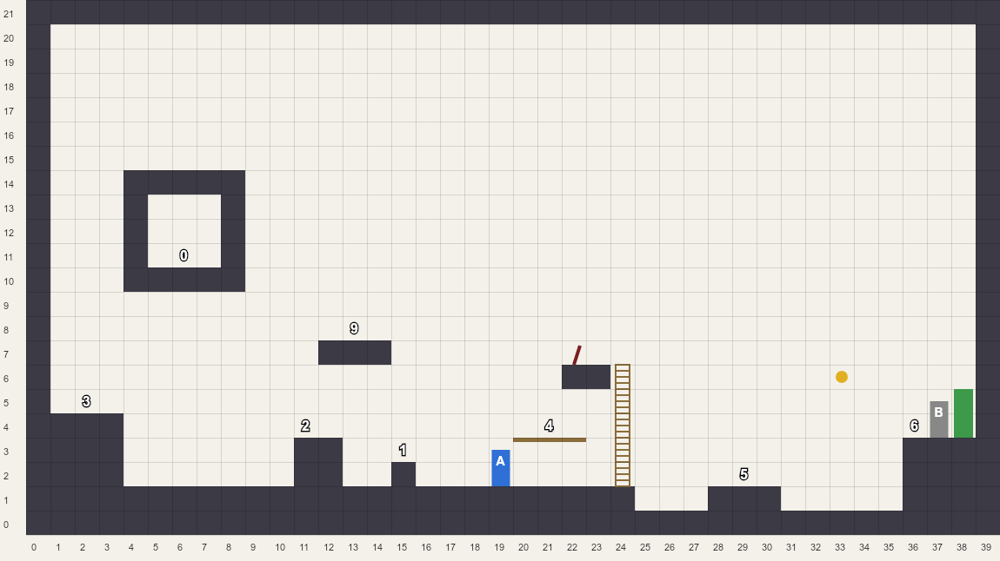

# Interface format test (milestone 2), 2026-11-20

Which way of showing the world do bots understand best? One scene, ten "can you get there alone?" questions, three formats, three models, two answers per question.

The right answers came from the engine trying every move with the rulebook's numbers: 5 places reachable, 5 not. A "yes" also had to come with a plan, which was played in the engine to see whether it works.

## Run 1: all three formats

| Model | Format | Right answers | Plans that work | Score |
|---|---|---|---|---|
| Haiku 5.5 | ASCII | 7/20 (12 unusable: cut off) | 0/10 | 23% |
| Haiku 5.5 | numbers + affordances | 20/20 | 7/10 | 90% |
| Haiku 5.5 | picture | 11/20 (5 unusable) | 2/10 | 43% |
| DeepSeek V4 Flash | ASCII | 14/20 | 1/10 | 50% |
| DeepSeek V4 Flash | numbers + affordances | 20/20 | 7/10 | 90% |
| Gemini 3.1 Flash-Lite | ASCII | 18/20 | 0/10 | 60% |
| Gemini 3.1 Flash-Lite | numbers + affordances | 20/20 | 5/10 | 83% |
| Gemini 3.1 Flash-Lite | picture | 17/20 | 1/10 | 60% |

The average score per format was 88% for numbers, 52% for the picture and 44% for ASCII. DeepSeek reads text only, so it had no picture. Cost: $0.048.

## Run 2: numbers, with plans worded as exact recipes

Run 1 introduced each plan with "e.g.", and the models rewrote the plans. One walked into a ledge instead of jumping onto it; another walked under the lever instead of to the ladder. Run 2 said "Plan: ..., copy it exactly".

| Model | Right answers | Plans that work | Score |
|---|---|---|---|
| Haiku 5.5 | 20/20 | 10/10 | 100% |
| DeepSeek V4 Flash | 20/20 | 10/10 | 100% |
| Gemini 3.1 Flash-Lite | 20/20 | 8/10 | 93% |

Cost: $0.010. Gemini's two misses mixed a neighbouring question's plan into its own.

## What it means

- **Numbers plus affordances wins**, as the spec expected. Milestone 3's view-builder uses it, with plans worded as exact recipes.
- **Pictures and ASCII make models count tiles.** Haiku counted out loud in its "thought" field and ran past the 400-token cap 40 times, although it was asked for 60 words. With numbers, it never did.
- **Even with exact plans, models sometimes improvise.** Proposed for milestone 3: a `go_to(place)` command that runs the engine's own plan, so a bot decides where to go and the engine handles how. Plans still assume nominal stats, so a bot's hidden stats still show in the results.

The raw answers, prompts and ledgers are in `runs/20261120-005759-format-test` and `runs/20261120-010057-format-test` (runs/ isn't in git). `npm run format-test -- --rescore <folder>` re-scores them for free.
